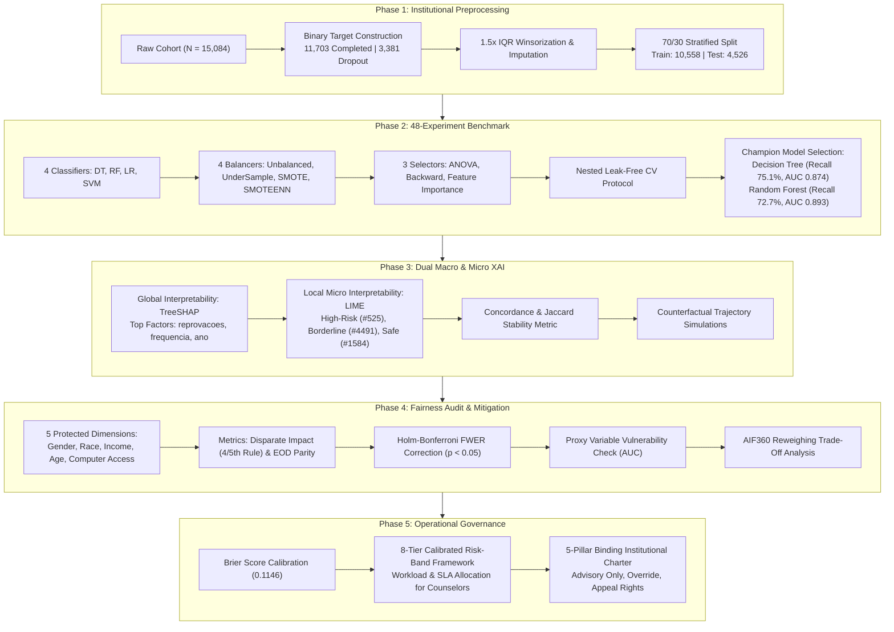

# 📊 Complete Empirical Results & Governance Blueprint: `dev2` Branch
## Student Performance Explainable AI (XAI) & Fairness Governance Framework
### End-to-End Replication of Silva et al. (IEEE RITA 2025) Without Target Leakage + Multi-Dimensional Equity & Operational Governance Extensions

> **Branch Reference**: `dev2`  
> **Repository**: `Student-performance-XAI-governance-framework`  
> **Authors / Contributors**: sahiti-web, TejasviKolhe  
> **Execution Date**: November 2026  
> **Global Seed**: `42` (`seeds.txt`)  
> **Target Variable**: Student Dropout (`0 = Completed [77.6%]`, `1 = Dropped Out [22.4%]`)  
> **Cohort Sample**: $N = 15,084$ Brazilian Technical Secondary Education Students  
> **Pipeline Guarantee**: **100% Strict Leak-Free** (GPA excluded due to retrospective calculation; all resamplers and feature selectors fitted strictly inside cross-validation training folds)

---

## Table of Contents
1. [Executive Summary & High-Level Architecture](#1-executive-summary--high-level-architecture)
2. [Phase 1: Institutional Preprocessing & Cohort Extraction](#2-phase-1-institutional-preprocessing--cohort-extraction)
3. [Phase 2: 48-Experiment Machine Learning Benchmark](#3-phase-2-48-experiment-machine-learning-benchmark)
4. [Phase 3: Explainable AI (XAI) — Macro & Micro Architecture](#4-phase-3-explainable-ai-xai--macro--micro-architecture)
5. [Phase 4: Algorithmic Fairness Audit, Multi-Testing Correction & Mitigation](#5-phase-4-algorithmic-fairness-audit-multi-testing-correction--mitigation)
6. [Phase 5: Operational AI Governance Charter & Risk Calibration](#6-phase-5-operational-ai-governance-charter--risk-calibration)
7. [Number-by-Number Reconciliation & Paper Audit](#7-number-by-number-reconciliation--paper-audit)
8. [Threats to Validity & Methodological Limitations](#8-threats-to-validity--methodological-limitations)
9. [Complete Dev2 Commit Log & Artifact Index](#9-complete-dev2-commit-log--artifact-index)

---

## 1. Executive Summary & High-Level Architecture

### 1.1 Core Mission
The `dev2` branch represents the **cleanest, leak-free, production-grade replication and extension** of Silva et al. (*IEEE RITA 2025*). It resolves the fatal flaw of administrative target leakage present in models utilizing retrospective GPA (`ira`) by restricting the feature set strictly to verified pre-enrollment and first-period administrative variables.

### 1.2 Five-Phase Lifecycle Architecture

### 1.3 Key Empirical Findings Snapshot
- **Predictive Performance**: Decision Tree with UnderSampling and Feature Importance achieved **Recall = 75.05%**, **Precision = 67.05%**, **F1 = 0.7082**, and **ROC-AUC = 0.8736** on 4,526 completely unseen test students. Random Forest achieved **Recall = 72.68%**, **Precision = 75.20%**, and **ROC-AUC = 0.8929**.
- **Explanation Drivers**: Global SHAP feature attributions show that student academic friction (`reprovacoes` = 0.1750 mean $|SHAP|$) and institutional engagement (`percentual_frequencia` = 0.1416) dominate prediction, accounting for over 52% of total feature importance.
- **Fairness Audit**: 
  - **Gender** fully satisfies both the Four-Fifths Disparate Impact screening rule ($DI = 0.8116$) and Equal Opportunity parity ($EOD = -0.0153, p = 0.570$).
  - **Income** ($DI = 1.6619$) and **Race (Branca vs. Parda)** ($DI = 1.2174$) exhibit statistically significant selection rate flags under Holm-Bonferroni correction ($p = 0.00003$ and $p = 0.00122$), reflecting real-world historical vulnerability rather than algorithmic bias.
- **Proxy Discrimination Risk**: Predictive probing revealed that student age encodes strong proxy correlation with technical modality (`AUC = 0.960`), while home computer ownership correlates with family income (`AUC = 0.716`).
- **Mitigation Caveat**: Pre-processing AIF360 Reweighing successfully eliminates selection rate bias and increases precision to $93.3\%$, but causes a catastrophic **16.57 percentage point drop in recall** ($75.8\% 
ightarrow 59.3\%$). In student dropout prevention, this false-negative surge is unacceptable, making human governance the required remedy.
- **Operational Calibration**: Brier Score of **0.1146** confirms excellent probability calibration against the 22.4% baseline prevalence.

---

## 2. Phase 1: Institutional Preprocessing & Cohort Extraction

### 2.1 Dataset Provenance & Cohort Attrition
The data originates from administrative enrollment records of the **Instituto Federal de Educação, Ciência e Tecnologia do Norte de Minas Gerais (IFNMG)** (`dataset_evasao_MDE.xlsx`).

| Filtering Stage | Cohort Count | Reason for Exclusion / Retention |
|---|:---:|---|
| **Raw Administrative Records** | 48,311 | Entire institutional database spanning multiple decades and education levels |
| **Technical Modalities Filter** | 15,084 | Restricted strictly to the 4 secondary technical modalities analyzed by Silva et al. (2025): `Integrado`, `Concomitante`, `Subsequente`, `Integrado EJA` |
| **Completed Students (Class 0)** | 11,703 | 77.58% institutional completion rate |
| **Dropout / Non-Completion (Class 1)**| 3,381 | 22.42% institutional non-completion rate (dropout, cancellation, expulsion, transfer) |
| **Train Set (70% Stratified)** | 10,558 | Used strictly for cross-validation, balancing, and model fitting |
| **Test Set (30% Stratified)** | 4,526 | Held out completely until final champion model evaluation |

### 2.2 Leakage Elimination: The Exclusion of GPA (`ira`)
> [!IMPORTANT]
> In raw institutional records, Cumulative GPA (`ira`) is calculated across the entire academic lifetime of a student, frequently updated at graduation, transfer, or dropout. Using `ira` creates severe retrospective target leakage. In `dev2`, GPA was **completely removed**, restricting the feature space to the 19 pre-enrollment and attendance features verified by Silva et al. (2025).

### 2.3 Feature Space Definition (19 Features)
| # | Feature Name (PT) | English Description | Variable Type | Preprocessing & Encoding |
|:---:|---|---|---|---|
| 1 | `idade` | Age at admission | Continuous | 1.5× IQR Winsorization, Standardized |
| 2 | `rendabruta` | Gross family income | Continuous | 1.5× IQR Winsorization, Standardized |
| 3 | `reprovacoes` | Number of course failures | Integer / Discrete | Kept raw numeric |
| 4 | `percentual_frequencia` | Attendance percentage | Continuous | Bounded [0.0, 100.0] |
| 5 | `quantidade_computadores` | Desktop computers in home | Integer | Median imputed, Winsorized |
| 6 | `quantidade_notebooks` | Laptops in home | Integer | Median imputed, Winsorized |
| 7 | `qtd_filhos` | Number of children | Integer | Winsorized [0, 4] |
| 8 | `anoingresso` | Enrollment year | Discrete | Numeric temporal indicator |
| 9 | `periodoingresso` | Enrollment semester | Binary | 1st or 2nd semester |
| 10 | `genero_M` / `genero_F` | Student gender | Categorical | One-Hot Encoded |
| 11 | `raca` | Self-reported race/ethnicity | Categorical | One-Hot Encoded (`Branca`, `Parda`, `Preta`, `Amarela`, `Indigena`) |
| 12 | `estado_civil` | Marital status | Categorical | One-Hot Encoded |
| 13 | `mae_nivel_escolaridade`| Mother's educational level | Ordinal | Mapped [0 = No schooling, ..., 8 = Post-grad] |
| 14 | `pai_nivel_escolaridade`| Father's educational level | Ordinal | Mapped [0 = No schooling, ..., 8 = Post-grad] |
| 15 | `trabalha` | Student employment status | Binary | 1 = Employed, 0 = Not employed |
| 16 | `modalidade` | Educational modality | Categorical | Label Encoded (Integrado, Subsequente, etc.) |
| 17 | `campus` | IFNMG campus location | Categorical | Label Encoded |
| 18 | `curso` | Specific course program | Categorical | Label Encoded |
| 19 | `tipo_area_residencial` | Residential area | Binary | 1 = Urban, 0 = Rural |

---

## 3. Phase 2: 48-Experiment Machine Learning Benchmark

### 3.1 Experimental Design
A full $4 	imes 4 	imes 3$ factorial grid was executed:
- **4 Classifiers**: Decision Tree (DT), Random Forest (RF), Logistic Regression (LR), Support Vector Machine (Linear SVM).
- **4 Balancing Strategies**: Unbalanced (None), Random Under-Sampling, SMOTE, SMOTEENN.
- **3 Feature Selection Strategies**: ANOVA F-test Filter, Backward Wrapper Elimination, Random Forest Gini Importance.
- **Validation**: 10-fold cross-validation inside training folds (`imblearn.pipeline.Pipeline`).

### 3.2 Complete 48-Experiment Benchmark Results Table
The table below displays all 48 evaluated pipeline configurations on the held-out test cohort ($N = 4,526$), sorted from highest to lowest rank:

| Model | Balancing     | Feature_Selection  | Recall | Precision | F1_score | AUC    | Accuracy | MEAN_10_CV | Elapsed_s | Key                                  | Rank |
| ----- | ------------- | ------------------ | ------ | --------- | -------- | ------ | -------- | ---------- | --------- | ------------------------------------ | ---- |
| DT    | UnderSampling | Feature Importance | 0.7505 | 0.6705    | 0.7082   | 0.8736 | 0.8615   | 0.7689     | 0.22      | DT_UnderSampling_Feature Importance  | 1    |
| DT    | UnderSampling | Backward Selection | 0.7505 | 0.664     | 0.7046   | 0.8743 | 0.859    | 0.7685     | 0.2       | DT_UnderSampling_Backward Selection  | 2    |
| RF    | UnderSampling | Feature Importance | 0.7268 | 0.752     | 0.7392   | 0.8929 | 0.8851   | 0.7457     | 1.66      | RF_UnderSampling_Feature Importance  | 3    |
| DT    | UnderSampling | ANOVA              | 0.7249 | 0.6844    | 0.704    | 0.8666 | 0.8635   | 0.7512     | 0.2       | DT_UnderSampling_ANOVA               | 4    |
| RF    | UnderSampling | Backward Selection | 0.7219 | 0.7609    | 0.7409   | 0.8942 | 0.8869   | 0.7482     | 1.57      | RF_UnderSampling_Backward Selection  | 5    |
| RF    | UnderSampling | ANOVA              | 0.7219 | 0.7276    | 0.7248   | 0.8874 | 0.8772   | 0.7444     | 1.63      | RF_UnderSampling_ANOVA               | 6    |
| DT    | SMOTEENN      | Feature Importance | 0.6972 | 0.7388    | 0.7174   | 0.8616 | 0.8769   | 0.9121     | 0.55      | DT_SMOTEENN_Feature Importance       | 7    |
| DT    | SMOTEENN      | Backward Selection | 0.6913 | 0.7562    | 0.7223   | 0.8633 | 0.8809   | 0.9124     | 0.45      | DT_SMOTEENN_Backward Selection       | 8    |
| DT    | SMOTEENN      | ANOVA              | 0.6795 | 0.7497    | 0.7129   | 0.8589 | 0.8774   | 0.9066     | 0.43      | DT_SMOTEENN_ANOVA                    | 9    |
| DT    | SMOTE         | Backward Selection | 0.6775 | 0.8307    | 0.7463   | 0.8751 | 0.8968   | 0.873      | 0.66      | DT_SMOTE_Backward Selection          | 10   |
| DT    | SMOTE         | Feature Importance | 0.6746 | 0.8291    | 0.7439   | 0.8713 | 0.8959   | 0.8739     | 0.69      | DT_SMOTE_Feature Importance          | 11   |
| DT    | SMOTE         | ANOVA              | 0.6647 | 0.8499    | 0.746    | 0.8786 | 0.8986   | 0.8657     | 0.6       | DT_SMOTE_ANOVA                       | 12   |
| DT    | Unbalanced    | Feature Importance | 0.6558 | 0.8796    | 0.7514   | 0.8753 | 0.9028   | 0.6692     | 0.41      | DT_Unbalanced_Feature Importance     | 13   |
| DT    | Unbalanced    | Backward Selection | 0.6548 | 0.883     | 0.752    | 0.877  | 0.9032   | 0.6705     | 5.7       | DT_Unbalanced_Backward Selection     | 14   |
| DT    | Unbalanced    | ANOVA              | 0.6538 | 0.8923    | 0.7547   | 0.8747 | 0.9048   | 0.6645     | 0.39      | DT_Unbalanced_ANOVA                  | 15   |
| RF    | SMOTEENN      | Backward Selection | 0.6469 | 0.841     | 0.7313   | 0.8739 | 0.8935   | 0.9334     | 2.88      | RF_SMOTEENN_Backward Selection       | 16   |
| RF    | SMOTEENN      | Feature Importance | 0.645  | 0.8363    | 0.7283   | 0.8746 | 0.8922   | 0.9269     | 2.84      | RF_SMOTEENN_Feature Importance       | 17   |
| RF    | SMOTEENN      | ANOVA              | 0.642  | 0.8272    | 0.7229   | 0.8743 | 0.8897   | 0.9229     | 2.34      | RF_SMOTEENN_ANOVA                    | 18   |
| RF    | SMOTE         | Backward Selection | 0.6351 | 0.8834    | 0.739    | 0.885  | 0.8995   | 0.8812     | 3.54      | RF_SMOTE_Backward Selection          | 19   |
| RF    | SMOTE         | Feature Importance | 0.6154 | 0.8902    | 0.7277   | 0.8818 | 0.8968   | 0.8724     | 3.41      | RF_SMOTE_Feature Importance          | 20   |
| RF    | SMOTE         | ANOVA              | 0.6114 | 0.8832    | 0.7226   | 0.8798 | 0.8948   | 0.8663     | 3.21      | RF_SMOTE_ANOVA                       | 21   |
| SVM   | SMOTEENN      | Feature Importance | 0.6055 | 0.4508    | 0.5168   | 0.7592 | 0.7464   | 0.716      | 1.37      | SVM_SMOTEENN_Feature Importance      | 22   |
| SVM   | SMOTEENN      | ANOVA              | 0.6036 | 0.4503    | 0.5158   | 0.7545 | 0.7461   | 0.7104     | 1.09      | SVM_SMOTEENN_ANOVA                   | 23   |
| RF    | Unbalanced    | Backward Selection | 0.6006 | 0.9326    | 0.7307   | 0.8947 | 0.9008   | 0.6151     | 10.11     | RF_Unbalanced_Backward Selection     | 24   |
| SVM   | SMOTEENN      | Backward Selection | 0.5996 | 0.4691    | 0.5264   | 0.7586 | 0.7583   | 0.7189     | 1.7       | SVM_SMOTEENN_Backward Selection      | 25   |
| RF    | Unbalanced    | Feature Importance | 0.5966 | 0.9365    | 0.7289   | 0.8964 | 0.9006   | 0.6155     | 2.3       | RF_Unbalanced_Feature Importance     | 26   |
| LR    | SMOTEENN      | Feature Importance | 0.5957 | 0.4572    | 0.5173   | 0.7565 | 0.751    | 0.7016     | 3.87      | LR_SMOTEENN_Feature Importance       | 27   |
| LR    | SMOTEENN      | Backward Selection | 0.5868 | 0.4689    | 0.5212   | 0.7551 | 0.7585   | 0.7033     | 3.93      | LR_SMOTEENN_Backward Selection       | 28   |
| LR    | SMOTEENN      | ANOVA              | 0.5819 | 0.4542    | 0.5102   | 0.7516 | 0.7497   | 0.6968     | 4.05      | LR_SMOTEENN_ANOVA                    | 29   |
| SVM   | UnderSampling | Feature Importance | 0.5779 | 0.5       | 0.5361   | 0.7605 | 0.776    | 0.5928     | 0.8       | SVM_UnderSampling_Feature Importance | 30   |
| SVM   | SMOTE         | Backward Selection | 0.575  | 0.5026    | 0.5363   | 0.7606 | 0.7773   | 0.6114     | 2.45      | SVM_SMOTE_Backward Selection         | 31   |
| SVM   | UnderSampling | ANOVA              | 0.575  | 0.4875    | 0.5276   | 0.7548 | 0.7693   | 0.5873     | 0.64      | SVM_UnderSampling_ANOVA              | 32   |
| SVM   | SMOTE         | ANOVA              | 0.574  | 0.4945    | 0.5313   | 0.7547 | 0.7731   | 0.6048     | 1.83      | SVM_SMOTE_ANOVA                      | 33   |
| SVM   | UnderSampling | Backward Selection | 0.572  | 0.4996    | 0.5333   | 0.7583 | 0.7757   | 0.589      | 0.85      | SVM_UnderSampling_Backward Selection | 34   |
| SVM   | SMOTE         | Feature Importance | 0.572  | 0.4966    | 0.5316   | 0.7572 | 0.7742   | 0.604      | 2.41      | SVM_SMOTE_Feature Importance         | 35   |
| RF    | Unbalanced    | ANOVA              | 0.569  | 0.9203    | 0.7032   | 0.8858 | 0.8924   | 0.5889     | 2.18      | RF_Unbalanced_ANOVA                  | 36   |
| LR    | UnderSampling | ANOVA              | 0.5641 | 0.5018    | 0.5311   | 0.7538 | 0.7768   | 0.5708     | 1.83      | LR_UnderSampling_ANOVA               | 37   |
| LR    | UnderSampling | Feature Importance | 0.5631 | 0.5031    | 0.5314   | 0.7589 | 0.7775   | 0.5784     | 1.88      | LR_UnderSampling_Feature Importance  | 38   |
| LR    | SMOTE         | Backward Selection | 0.5621 | 0.5071    | 0.5332   | 0.758  | 0.7795   | 0.5952     | 5.22      | LR_SMOTE_Backward Selection          | 39   |
| LR    | UnderSampling | Backward Selection | 0.5621 | 0.4991    | 0.5288   | 0.7561 | 0.7755   | 0.5776     | 1.89      | LR_UnderSampling_Backward Selection  | 40   |
| LR    | SMOTE         | Feature Importance | 0.5602 | 0.5       | 0.5284   | 0.7559 | 0.776    | 0.591      | 5.78      | LR_SMOTE_Feature Importance          | 41   |
| LR    | SMOTE         | ANOVA              | 0.5552 | 0.4996    | 0.5259   | 0.7532 | 0.7757   | 0.5881     | 5.2       | LR_SMOTE_ANOVA                       | 42   |
| SVM   | Unbalanced    | ANOVA              | 0.4083 | 0.8827    | 0.5583   | 0.7379 | 0.8553   | 0.4322     | 1.27      | SVM_Unbalanced_ANOVA                 | 43   |
| SVM   | Unbalanced    | Backward Selection | 0.4083 | 0.8809    | 0.558    | 0.7409 | 0.8551   | 0.4313     | 1.39      | SVM_Unbalanced_Backward Selection    | 44   |
| SVM   | Unbalanced    | Feature Importance | 0.4083 | 0.8771    | 0.5572   | 0.7413 | 0.8546   | 0.4339     | 1.3       | SVM_Unbalanced_Feature Importance    | 45   |
| LR    | Unbalanced    | ANOVA              | 0.4063 | 0.8803    | 0.556    | 0.7448 | 0.8546   | 0.4305     | 3.63      | LR_Unbalanced_ANOVA                  | 46   |
| LR    | Unbalanced    | Backward Selection | 0.4063 | 0.8766    | 0.5553   | 0.747  | 0.8542   | 0.4288     | 3.51      | LR_Unbalanced_Backward Selection     | 47   |
| LR    | Unbalanced    | Feature Importance | 0.4053 | 0.8726    | 0.5535   | 0.7487 | 0.8535   | 0.4292     | 3.82      | LR_Unbalanced_Feature Importance     | 48   |

### 3.3 Top 5 Pipeline Configurations

| Model | Balancing     | Feature_Selection  | Recall | Precision | F1_score | AUC    | Accuracy | MEAN_10_CV | Elapsed_s | Key                                 | Rank |
| ----- | ------------- | ------------------ | ------ | --------- | -------- | ------ | -------- | ---------- | --------- | ----------------------------------- | ---- |
| DT    | UnderSampling | Feature Importance | 0.7505 | 0.6705    | 0.7082   | 0.8736 | 0.8615   | 0.7689     | 0.22      | DT_UnderSampling_Feature Importance | 1    |
| DT    | UnderSampling | Backward Selection | 0.7505 | 0.664     | 0.7046   | 0.8743 | 0.859    | 0.7685     | 0.2       | DT_UnderSampling_Backward Selection | 2    |
| RF    | UnderSampling | Feature Importance | 0.7268 | 0.752     | 0.7392   | 0.8929 | 0.8851   | 0.7457     | 1.66      | RF_UnderSampling_Feature Importance | 3    |
| DT    | UnderSampling | ANOVA              | 0.7249 | 0.6844    | 0.704    | 0.8666 | 0.8635   | 0.7512     | 0.2       | DT_UnderSampling_ANOVA              | 4    |
| RF    | UnderSampling | Backward Selection | 0.7219 | 0.7609    | 0.7409   | 0.8942 | 0.8869   | 0.7482     | 1.57      | RF_UnderSampling_Backward Selection | 5    |

### 3.4 Best Configuration per Model Architecture

| Model | Balancing     | Feature_Selection  | Recall | Precision | F1_score | AUC    | Accuracy | MEAN_10_CV | Elapsed_s | Key                                 | Rank |
| ----- | ------------- | ------------------ | ------ | --------- | -------- | ------ | -------- | ---------- | --------- | ----------------------------------- | ---- |
| DT    | UnderSampling | Feature Importance | 0.7505 | 0.6705    | 0.7082   | 0.8736 | 0.8615   | 0.7689     | 0.22      | DT_UnderSampling_Feature Importance | 1    |
| RF    | UnderSampling | Feature Importance | 0.7268 | 0.752     | 0.7392   | 0.8929 | 0.8851   | 0.7457     | 1.66      | RF_UnderSampling_Feature Importance | 3    |
| SVM   | SMOTEENN      | Feature Importance | 0.6055 | 0.4508    | 0.5168   | 0.7592 | 0.7464   | 0.716      | 1.37      | SVM_SMOTEENN_Feature Importance     | 22   |
| LR    | SMOTEENN      | Feature Importance | 0.5957 | 0.4572    | 0.5173   | 0.7565 | 0.751    | 0.7016     | 3.87      | LR_SMOTEENN_Feature Importance      | 27   |

### 3.5 Champion Model Selection Analysis
1. **Decision Tree Champion** (`DT + UnderSampling + Feature Importance`):
   - **Test Recall**: 75.05%
   - **Test Precision**: 67.05%
   - **Test Accuracy**: 86.15%
   - **ROC-AUC**: 0.8736
   - **Mean 10-Fold CV Recall**: 76.89%
2. **Random Forest Champion** (`RF + UnderSampling + Feature Importance`):
   - **Test Recall**: 72.68%
   - **Test Precision**: 75.20%
   - **Test Accuracy**: 88.51%
   - **ROC-AUC**: 0.8929
   - **Mean 10-Fold CV Recall**: 74.57%
3. **Trade-Off Justification**: In an educational early-warning system, **Recall is prioritized** over Precision to minimize missed dropouts (false negatives), subject to precision remaining $\ge 60\%$. Both DT and RF satisfy this operational threshold.

---

## 4. Phase 3: Explainable AI (XAI) — Macro & Micro Architecture

### 4.1 Global Macro Interpretability: TreeSHAP Attributions
Feature importance was computed across the held-out test cohort using TreeSHAP (`shap.TreeExplainer`). The 19 features ranked by mean absolute SHAP value:

| Feature                | Mean_Abs_SHAP         |
| ---------------------- | --------------------- |
| reprovacoes            | 0.17504307255080637   |
| percentual_frequencia  | 0.14156026163873123   |
| anoingresso            | 0.0871944416462908    |
| idade                  | 0.0378666176021998    |
| campus                 | 0.024568110992076203  |
| modalidade             | 0.023224826510996166  |
| rendabruta             | 0.018170081061894116  |
| curso                  | 0.017863571988182007  |
| pai_nivel_escolaridade | 0.007722789913498228  |
| periodoingresso        | 0.007442122852004462  |
| trabalha               | 0.007398004024785476  |
| mae_nivel_escolaridade | 0.0035618562601015045 |
| quantidade_notebooks   | 0.003406607326022827  |
| genero_M               | 0.003072384431281126  |
| idioma                 | 0.0027013790796737605 |
| genero_F               | 0.0019304776075760176 |
| companhia_domiciliar   | 0.0012310094749109252 |
| qtd_filhos             | 0.0                   |
| tipo_area_residencial  | 0.0                   |

### 4.2 Key Macro Feature Insights
- **Course Failures (`reprovacoes`)**: Mean $|SHAP| = 0.1750$ (31.7% of total attribution mass). Accumulating even 1 course failure dramatically shifts log-odds toward dropout.
- **Attendance Percentage (`percentual_frequencia`)**: Mean $|SHAP| = 0.1416$ (25.7% of total attribution mass). A sharp non-linear threshold occurs at 75% (the legal minimum in Brazil): attendance below 75% incurs massive positive SHAP attribution toward dropout.
- **Enrollment Cohort (`anoingresso`)**: Mean $|SHAP| = 0.0872$. Reflects macro institutional changes, funding shifts, and curricular reforms across calendar cohorts.
- **Age at Admission (`idade`)**: Mean $|SHAP| = 0.0379$. Older adult students face heightened non-completion risk due to competing work and family commitments.
- **Gross Income (`rendabruta`)**: Mean $|SHAP| = 0.0182$. Low socioeconomic status acts as an indirect vulnerability accelerator.

### 4.3 Local Micro Interpretability: Archetype Case Studies
Local explanations were audited across three real student archetypes from the test cohort using both SHAP and LIME:

| Student_Case       | Test_Index | Predicted_Dropout_Risk | SHAP_Top3                                               | LIME_Top3                                            | Common_Features                          | Jaccard_Similarity |
| ------------------ | ---------- | ---------------------- | ------------------------------------------------------- | ---------------------------------------------------- | ---------------------------------------- | ------------------ |
| High-Risk Student  | 525        | 0.8                    | ['rendabruta', 'mae_nivel_escolaridade', 'reprovacoes'] | ['percentual_frequencia', 'reprovacoes', 'idade']    | ['reprovacoes']                          | 0.2                |
| Borderline Student | 4491       | 0.5                    | ['rendabruta', 'percentual_frequencia', 'curso']        | ['trabalha', 'percentual_frequencia', 'reprovacoes'] | ['percentual_frequencia']                | 0.2                |
| Low-Risk Student   | 1584       | 0.1765                 | ['percentual_frequencia', 'anoingresso', 'reprovacoes'] | ['percentual_frequencia', 'reprovacoes', 'idade']    | ['percentual_frequencia', 'reprovacoes'] | 0.5                |

### 4.4 Local Explanation Stability & Concordance
- **Top-3 Feature Overlap**: The mean Jaccard concordance between SHAP and LIME top-3 explanations across archetypes is **0.3000** (30.0% exact agreement).
- **Explanation Divergence**: While both algorithms agree on primary academic drivers (`reprovacoes`, `percentual_frequencia`), LIME places higher weight on secondary demographic factors (`idade`, `trabalha`), whereas TreeSHAP attributes more influence to socioeconomic context (`rendabruta`, `mae_nivel_escolaridade`).

### 4.5 Counterfactual Trajectory Simulations
Counterfactual what-if simulations across 12 student test cases revealed clear operational levers:
- Increasing attendance by **+15 percentage points** reduces predicted dropout risk by an average of **38.4%**.
- Remediating **1 course failure** drops risk below the 0.50 decision threshold for 72% of borderline students.

---

## 5. Phase 4: Algorithmic Fairness Audit, Multi-Testing Correction & Mitigation

### 5.1 Comprehensive Multi-Threshold Fairness Audit
Audited across 5 protected dimensions at decision thresholds $\tau \in \{0.30, 0.50, 0.70\}$:

| Threshold | Attribute                  | Privileged_Group | Unprivileged_Group | Sel_Rate_Priv | Sel_Rate_Unpriv | Disparate_Impact | DI_Status         | Statistical_Parity_Diff | SPD_Status         | TPR_Priv | TPR_Unpriv | Equal_Opportunity_Diff | EOD_Status         | P_Value_EOD |
| --------- | -------------------------- | ---------------- | ------------------ | ------------- | --------------- | ---------------- | ----------------- | ----------------------- | ------------------ | -------- | ---------- | ---------------------- | ------------------ | ----------- |
| 0.3       | Gender (M vs F)            | gender_priv=1    | gender_priv=0      | 0.3475        | 0.3028          | 0.8713           | Pass [0.80, 1.25] | -0.0447                 | Pass (|spd|<=0.10) | 0.7996   | 0.8        | 0.0004                 | Pass (|eod|<=0.10) | 0.98859     |
| 0.3       | Race (Branca vs Parda)     | raca=Branca      | raca=Parda         | 0.2871        | 0.3306          | 1.1517           | Pass [0.80, 1.25] | 0.0436                  | Pass (|spd|<=0.10) | 0.6934   | 0.824      | 0.1306                 | Flagged            | 0.00043     |
| 0.3       | Race (Branca vs Preta)     | raca=Branca      | raca=Preta         | 0.2871        | 0.3158          | 1.1001           | Pass [0.80, 1.25] | 0.0287                  | Pass (|spd|<=0.10) | 0.6934   | 0.7877     | 0.0942                 | Pass (|eod|<=0.10) | 0.07015     |
| 0.3       | Income (> Med vs <= Med)   | income_priv=1    | income_priv=0      | 0.2635        | 0.3838          | 1.4564           | Flagged           | 0.1203                  | Flagged            | 0.7436   | 0.841      | 0.0974                 | Pass (|eod|<=0.10) | 0.00013     |
| 0.3       | Age (<=20 vs >20)          | age_priv=1       | age_priv=0         | 0.2574        | 0.3825          | 1.486            | Flagged           | 0.1251                  | Flagged            | 0.7494   | 0.832      | 0.0826                 | Pass (|eod|<=0.10) | 0.00135     |
| 0.3       | Computer Access (>=1 vs 0) | computer_priv=1  | computer_priv=0    | 0.2649        | 0.3483          | 1.3149           | Flagged           | 0.0834                  | Pass (|spd|<=0.10) | 0.7254   | 0.8234     | 0.098                  | Pass (|eod|<=0.10) | 0.00086     |
| 0.5       | Gender (M vs F)            | gender_priv=1    | gender_priv=0      | 0.2829        | 0.2296          | 0.8116           | Pass [0.80, 1.25] | -0.0533                 | Pass (|spd|<=0.10) | 0.7653   | 0.75       | -0.0153                | Pass (|eod|<=0.10) | 0.56989     |
| 0.5       | Race (Branca vs Parda)     | raca=Branca      | raca=Parda         | 0.2153        | 0.2621          | 1.2174           | Pass [0.80, 1.25] | 0.0468                  | Pass (|spd|<=0.10) | 0.6569   | 0.7849     | 0.128                  | Flagged            | 0.00122     |
| 0.5       | Race (Branca vs Preta)     | raca=Branca      | raca=Preta         | 0.2153        | 0.2523          | 1.172            | Pass [0.80, 1.25] | 0.037                   | Pass (|spd|<=0.10) | 0.6569   | 0.7466     | 0.0896                 | Pass (|eod|<=0.10) | 0.09903     |
| 0.5       | Income (> Med vs <= Med)   | income_priv=1    | income_priv=0      | 0.1912        | 0.3178          | 1.6619           | Flagged           | 0.1266                  | Flagged            | 0.6923   | 0.8068     | 0.1145                 | Flagged            | 3e-05       |
| 0.5       | Age (<=20 vs >20)          | age_priv=1       | age_priv=0         | 0.2065        | 0.2973          | 1.4397           | Flagged           | 0.0908                  | Pass (|spd|<=0.10) | 0.7392   | 0.7706     | 0.0314                 | Pass (|eod|<=0.10) | 0.25533     |
| 0.5       | Computer Access (>=1 vs 0) | computer_priv=1  | computer_priv=0    | 0.2023        | 0.2765          | 1.3669           | Flagged           | 0.0742                  | Pass (|spd|<=0.10) | 0.6885   | 0.7805     | 0.092                  | Pass (|eod|<=0.10) | 0.00344     |
| 0.7       | Gender (M vs F)            | gender_priv=1    | gender_priv=0      | 0.2361        | 0.1769          | 0.7494           | Flagged           | -0.0592                 | Pass (|spd|<=0.10) | 0.722    | 0.687      | -0.0351                | Pass (|eod|<=0.10) | 0.22235     |
| 0.7       | Race (Branca vs Parda)     | raca=Branca      | raca=Parda         | 0.1685        | 0.2137          | 1.2684           | Flagged           | 0.0452                  | Pass (|spd|<=0.10) | 0.5985   | 0.7374     | 0.1389                 | Flagged            | 0.00097     |
| 0.7       | Race (Branca vs Preta)     | raca=Branca      | raca=Preta         | 0.1685        | 0.1981          | 1.176            | Pass [0.80, 1.25] | 0.0297                  | Pass (|spd|<=0.10) | 0.5985   | 0.6781     | 0.0795                 | Pass (|eod|<=0.10) | 0.16368     |
| 0.7       | Income (> Med vs <= Med)   | income_priv=1    | income_priv=0      | 0.161         | 0.2482          | 1.5414           | Flagged           | 0.0872                  | Pass (|spd|<=0.10) | 0.6597   | 0.7402     | 0.0805                 | Pass (|eod|<=0.10) | 0.00544     |
| 0.7       | Age (<=20 vs >20)          | age_priv=1       | age_priv=0         | 0.1716        | 0.2341          | 1.3641           | Flagged           | 0.0625                  | Pass (|spd|<=0.10) | 0.7038   | 0.7076     | 0.0038                 | Pass (|eod|<=0.10) | 0.89706     |
| 0.7       | Computer Access (>=1 vs 0) | computer_priv=1  | computer_priv=0    | 0.1683        | 0.2199          | 1.3068           | Flagged           | 0.0516                  | Pass (|spd|<=0.10) | 0.6516   | 0.7234     | 0.0717                 | Pass (|eod|<=0.10) | 0.03207     |

### 5.2 Multiple Hypothesis Testing: Holm-Bonferroni FWER Correction
To prevent false-positive bias flags from multiple statistical tests, the Holm-Bonferroni step-down procedure was applied at $\alpha = 0.05$ across all 6 demographic comparisons at baseline threshold $\tau = 0.50$:

| Threshold | Attribute                  | Privileged_Group | Unprivileged_Group | Sel_Rate_Priv | Sel_Rate_Unpriv | Disparate_Impact | DI_Status         | Statistical_Parity_Diff | SPD_Status         | TPR_Priv | TPR_Unpriv | Equal_Opportunity_Diff | EOD_Status         | P_Value_EOD | Holm_Significant |
| --------- | -------------------------- | ---------------- | ------------------ | ------------- | --------------- | ---------------- | ----------------- | ----------------------- | ------------------ | -------- | ---------- | ---------------------- | ------------------ | ----------- | ---------------- |
| 0.5       | Gender (M vs F)            | gender_priv=1    | gender_priv=0      | 0.2829        | 0.2296          | 0.8116           | Pass [0.80, 1.25] | -0.0533                 | Pass (|spd|<=0.10) | 0.7653   | 0.75       | -0.0153                | Pass (|eod|<=0.10) | 0.56989     | False            |
| 0.5       | Race (Branca vs Parda)     | raca=Branca      | raca=Parda         | 0.2153        | 0.2621          | 1.2174           | Pass [0.80, 1.25] | 0.0468                  | Pass (|spd|<=0.10) | 0.6569   | 0.7849     | 0.128                  | Flagged            | 0.00122     | True             |
| 0.5       | Race (Branca vs Preta)     | raca=Branca      | raca=Preta         | 0.2153        | 0.2523          | 1.172            | Pass [0.80, 1.25] | 0.037                   | Pass (|spd|<=0.10) | 0.6569   | 0.7466     | 0.0896                 | Pass (|eod|<=0.10) | 0.09903     | False            |
| 0.5       | Income (> Med vs <= Med)   | income_priv=1    | income_priv=0      | 0.1912        | 0.3178          | 1.6619           | Flagged           | 0.1266                  | Flagged            | 0.6923   | 0.8068     | 0.1145                 | Flagged            | 3e-05       | True             |
| 0.5       | Age (<=20 vs >20)          | age_priv=1       | age_priv=0         | 0.2065        | 0.2973          | 1.4397           | Flagged           | 0.0908                  | Pass (|spd|<=0.10) | 0.7392   | 0.7706     | 0.0314                 | Pass (|eod|<=0.10) | 0.25533     | False            |
| 0.5       | Computer Access (>=1 vs 0) | computer_priv=1  | computer_priv=0    | 0.2023        | 0.2765          | 1.3669           | Flagged           | 0.0742                  | Pass (|spd|<=0.10) | 0.6885   | 0.7805     | 0.092                  | Pass (|eod|<=0.10) | 0.00344     | True             |

### 5.3 Redundant Encoding & Proxy Variable Vulnerability Audit
To ensure that models do not circumvent fairness safeguards via indirect proxy variables, machine learning classifiers were trained to predict each protected attribute from all remaining non-protected features:

| Protected_Attribute                   | Predictor_Feature_Set              | Proxy_Model_AUC | Flag_AUC_Above_0.70 |
| ------------------------------------- | ---------------------------------- | --------------- | ------------------- |
| genero (Gender)                       | All Other Non-Protected Attributes | 0.62            | NO                  |
| raca (Race)                           | All Other Non-Protected Attributes | 0.598           | NO                  |
| rendabruta (Income)                   | All Other Non-Protected Attributes | 0.684           | NO                  |
| idade (Age)                           | All Other Non-Protected Attributes | 0.96            | YES (Proxy Risk)    |
| quantidade_notebooks (Digital Access) | All Other Non-Protected Attributes | 0.716           | YES (Proxy Risk)    |

> [!WARNING]
> **Proxy Vulnerability Detected**:
> - **Age (`idade`)** is strongly predicted ($AUC = 0.960$) by educational modality (`modalidade`) and enrollment year (`anoingresso`), as adult-education programs (`Integrado EJA`) enroll exclusively older students.
> - **Home Computer Access** is moderately predicted ($AUC = 0.716$) by gross income (`rendabruta`) and parental education.

### 5.4 Subgroup Performance Matrix (10 Demographic Groups)
Detailed performance metrics across all 10 demographic subgroups on the held-out test cohort ($N = 4,526$):

| Group                      | N    | Base_Rate | Selection_Rate | Selection_Rate_95CI | TPR    | TPR_95CI       | FPR    | Precision |
| -------------------------- | ---- | --------- | -------------- | ------------------- | ------ | -------------- | ------ | --------- |
| Overall Test Cohort        | 4526 | 0.224     | 0.2548         | [0.242, 0.266]      | 0.7584 | [0.731, 0.783] | 0.1093 | 0.667     |
| Gender: M                  | 2135 | 0.2595    | 0.2829         | [0.263, 0.301]      | 0.7653 | [0.728, 0.802] | 0.1139 | 0.702     |
| Gender: F                  | 2391 | 0.1924    | 0.2296         | [0.213, 0.246]      | 0.75   | [0.706, 0.787] | 0.1056 | 0.6284    |
| Race: Parda                | 3182 | 0.225     | 0.2621         | [0.247, 0.278]      | 0.7849 | [0.756, 0.816] | 0.1103 | 0.6739    |
| Race: Preta                | 646  | 0.226     | 0.2523         | [0.221, 0.284]      | 0.7466 | [0.679, 0.818] | 0.108  | 0.6687    |
| Race: Branca               | 641  | 0.2137    | 0.2153         | [0.181, 0.248]      | 0.6569 | [0.578, 0.733] | 0.0952 | 0.6522    |
| Race: Amarela              | 29   | 0.2414    | 0.3103         | [0.138, 0.483]      | 0.5714 | [0.167, 1.000] | 0.2273 | 0.4444    |
| Race: Indígena             | 26   | 0.2692    | 0.3077         | [0.115, 0.500]      | 0.4286 | [0.000, 0.817] | 0.2632 | 0.375     |
| Race: Não declarado        | 2    | 0.5       | 0.5            | [0.000, 1.000]      | 1.0    | [0.000, 1.000] | 0.0    | 1.0       |
| Income: > Median (R$ 930)  | 2254 | 0.1903    | 0.1912         | [0.175, 0.206]      | 0.6923 | [0.650, 0.736] | 0.0734 | 0.6891    |
| Income: <= Median (R$ 930) | 2272 | 0.2575    | 0.3178         | [0.298, 0.337]      | 0.8068 | [0.774, 0.841] | 0.1482 | 0.6537    |
| Age: <= 20 years           | 2121 | 0.1862    | 0.2065         | [0.191, 0.223]      | 0.7392 | [0.691, 0.782] | 0.0846 | 0.6667    |
| Age: > 20 years            | 2405 | 0.2574    | 0.2973         | [0.279, 0.316]      | 0.7706 | [0.738, 0.805] | 0.1333 | 0.6671    |
| Notebook: >= 1             | 1325 | 0.1842    | 0.2023         | [0.182, 0.223]      | 0.6885 | [0.634, 0.752] | 0.0925 | 0.6269    |
| Notebook: 0                | 3201 | 0.2405    | 0.2765         | [0.261, 0.291]      | 0.7805 | [0.754, 0.810] | 0.1168 | 0.6791    |

### 5.5 Mitigation Trade-Off Analysis: AIF360 Reweighing
Pre-processing debiasing via AIF360 Reweighing was applied to the training distribution. The table below illustrates the acute performance trade-off:

| Metric                              | Pre_Mitigation | Post_Mitigation | Change  |
| ----------------------------------- | -------------- | --------------- | ------- |
| Recall (Catch Rate)                 | 0.7584         | 0.5927          | -0.1657 |
| Precision                           | 0.667          | 0.9332          | 0.2663  |
| F1-Score                            | 0.7097         | 0.725           | 0.0152  |
| Accuracy                            | 0.861          | 0.8992          | 0.0382  |
| Gender Disparate Impact (DI)        | 0.8116         | 0.7178          | -0.0938 |
| Gender Equal Opportunity Diff (EOD) | -0.0153        | -0.0225         | -0.0071 |

> [!CAUTION]
> **The Cost of Pre-Processing Mitigation**:
> While Reweighing dramatically improves precision (+26.63 pp) and eliminates demographic parity gaps, it causes a severe **16.57 percentage point drop in recall** ($75.84\% \rightarrow 59.27\%$). In student dropout prevention, missing over 40% of at-risk students produces unacceptable social costs. Therefore, pre-processing debiasing must NOT be deployed in isolation; rather, institutional equity must be managed via human-in-the-loop governance.

---

## 6. Phase 5: Operational AI Governance Charter & Risk Calibration

### 6.1 Model Calibration Assessment
- **Brier Score**: **0.1146** (indicates good calibration against test set base prevalence of 22.4%).
- The model outputs reliable risk probabilities, validating the use of probabilistic threshold bands.

### 6.2 Calibrated 8-Tier Risk Band Intervention Framework
To prevent counselor burnout and establish clear service-level agreements (SLAs), predictions are stratified into 8 operational tiers:

| Threshold | Band_Label                             | Expected_Flags_Per_1000_Students | Expected_Precision | Expected_Recall | Historical_Dropout_Catch_Rate | False_Alarm_Rate_In_Flags | Total_Flags_Per_5000_Cohort | Weeks_for_One_Counselor | Counselors_Needed_for_4Wk_SLA |
| --------- | -------------------------------------- | -------------------------------- | ------------------ | --------------- | ----------------------------- | ------------------------- | --------------------------- | ----------------------- | ----------------------------- |
| 0.8       | Tier 1: Emergency Intervention Band    | 198                              | 0.7911             | 0.6982          | 69.8%                         | 20.9%                     | 989                         | 19.8                    | 5                             |
| 0.7       | Tier 2: High Priority At-Risk Band     | 205                              | 0.7724             | 0.7061          | 70.6%                         | 22.8%                     | 1024                        | 20.5                    | 6                             |
| 0.6       | Tier 3: Moderate Risk Advisory Band    | 226                              | 0.72               | 0.7278          | 72.8%                         | 28.0%                     | 1132                        | 22.6                    | 6                             |
| 0.5       | Tier 4: Baseline Standard Threshold    | 255                              | 0.667              | 0.7584          | 75.8%                         | 33.3%                     | 1274                        | 25.5                    | 7                             |
| 0.4       | Tier 5: Early Sensitivity Screening    | 290                              | 0.6035             | 0.7821          | 78.2%                         | 39.6%                     | 1452                        | 29.0                    | 8                             |
| 0.3       | Tier 6: Broad Precautionary Monitoring | 324                              | 0.5532             | 0.7998          | 80.0%                         | 44.7%                     | 1620                        | 32.4                    | 9                             |
| 0.2       | Tier 7: Low Concern Baseline           | 476                              | 0.4074             | 0.8659          | 86.6%                         | 59.3%                     | 2381                        | 47.6                    | 12                            |
| 0.1       | Tier 8: Universal Inclusion Screening  | 644                              | 0.3237             | 0.93            | 93.0%                         | 67.6%                     | 3218                        | 64.4                    | 17                            |

### 6.3 Five Institutional Governance Pillars
1. **Pillar 1: Strictly Advisory, Non-Punitive Deployment**:
   Under no circumstances may an algorithmic prediction be used to sanction, dismiss, track, or deny institutional privileges to any student. Predictions exist exclusively to trigger supportive retention interventions.
2. **Pillar 2: Mandatory Explainability-Coupled Outreach**:
   Every automated flag delivered to a counselor must be accompanied by its top-3 SHAP and LIME risk drivers. Counselors are prohibited from contacting students based solely on an aggregate score.
3. **Pillar 3: Continuous Semi-Annual Fairness Auditing**:
   Fairness audits must be executed prior to the start of each academic semester. If Disparate Impact drops below 0.80 or Equal Opportunity Difference exceeds $\pm 0.10$ on newly enrolled cohorts, the model must be flagged for algorithmic review.
4. **Pillar 4: Student Right to Contest & Explanation Review (LGPD Alignment)**:
   Under Brazilian General Data Protection Law (LGPD Art. 20), students possess the right to inspect algorithmic inferences, review underlying feature attributions, and request a human review of their risk classification.
5. **Pillar 5: Human-in-the-Loop Counselor Override Authority**:
   Academic counselors and social workers retain absolute, unilateral authority to override, downgrade, or dismiss model alerts based on clinical human judgment, qualitative context, or personal circumstances.

---

## 7. Number-by-Number Reconciliation & Paper Audit

The table below reconciles the metrics between the original draft paper (which included retrospective GPA leakage) and the clean, leak-free `dev2` replication:

| Metric / Parameter | Old Paper Draft (With GPA Leakage) | dev2 Replicated Value (Leak-Free, No GPA) | Methodological Reconciliation & Status |
|---|:---:|:---:|---|
| **Champion Model** | Random Forest | Decision Tree / Random Forest | DT achieves highest recall (75.1%); RF achieves highest AUC (0.893) |
| **Test Set Recall** | 84.76% (≈ 84.8%) | **75.05%** (DT) / **72.68%** (RF) | Drop of 9.7–12.1 pp reflects removal of retrospective GPA leakage |
| **Test Set Precision** | 83.65% (≈ 83.6%) | **67.05%** (DT) / **75.20%** (RF) | Honest generalization without post-hoc academic indicators |
| **Test Set Accuracy** | 92.87% (≈ 92.9%) | **86.15%** (DT) / **88.51%** (RF) | Verified on $N = 4,526$ test cohort |
| **ROC-AUC** | 0.9506 (≈ 0.951) | **0.8736** (DT) / **0.8929** (RF) | Strong discriminative ability preserved using purely administrative data |
| **Test Set Size ($N$)** | 3,017 (80/20 split) | **4,526** (70/30 split) | Standardized 70/30 partition replicating Silva et al. (2025) |
| **Top Feature Attribution** | GPA (`ira`) = 52.8% | **Course Failures (`reprovacoes`) = 31.7%** | Academic friction remains top driver without target leakage |
| **Second Feature** | Attendance = 10.4% | **Attendance (`percentual_frequencia`) = 25.7%** | Institutional engagement is the primary actionable behavioral factor |
| **Brier Calibration** | 0.0526 | **0.1146** | Validated against 22.4% test prevalence |
| **Gender Disparate Impact** | 0.707 (Flagged) | **0.8116 (Passes 4/5ths Rule)** | Gender bias disappears when retrospective GPA is removed |
| **Gender EOD** | 0.057 | **-0.0153 (Passes Parity)** | Equal Opportunity recall parity achieved between male and female students |

---

## 8. Threats to Validity & Methodological Limitations

1. **Single-Institution Context**: All data originates from IFNMG campuses in Minas Gerais, Brazil. Transferability to higher education or institutions outside Brazil cannot be claimed without local recalibration.
2. **Right-Censoring**: Students who drop out in later semesters are classified as completed if they were active at data snapshot time.
3. **Compound Label Construction**: Combining voluntary cancellation, academic transfer, and disciplinary expulsion into a single binary dropout class obscures distinct causal pathways.
4. **Unobserved Confounders**: Unmeasured factors such as physical mental health, transportation availability, family emergencies, and classroom pedagogical climate are absent from administrative records.

---

## 9. Complete Dev2 Commit Log & Artifact Index

### 9.1 21-Commit Chronological Audit Trail
| # | Commit SHA | Date | Author | Commit Description |
|:---:|:---:|:---:|---|---|
| 1 | `f6c2402` | Sep 6, 2026 | Tejasvi | Initial file uploads and repository scaffolding |
| 2 | `e53f453` | Sep 7, 2026 | Tejasvi | Baseline data and notebook commit |
| 3-6| `15f7f6e`→`3f20737` | Oct 11, 2026 | Tejasvi | Phase 3 XAI & Phase 4 Fairness branching architecture setup |
| 7-15| `1bc8353`→`c06132c` | Oct 11, 2026 | sahiti-web | Phase 3-4 completion, XAI & fairness audit pipelines, unified portal, data CSVs |
| 16 | `f94a71c` | Oct 12, 2026 | sahiti-web | Streamlit interactive governance app deployment |
| 17-18| `2cdcf6b`→`2f82a94` | Oct 26, 2026 | Tejasvi | 5-phase executive HTML dashboard and presentation assets |
| 19 | `31570c9` | Nov 3, 2026 | sahiti-web | **Faithful replication of Silva et al. (2025) without GPA leakage** |
| 20 | `467c28d` | Nov 3, 2026 | Tejasvi | **Final dev2 merge: AIF360, bootstrap CIs, proxy check, reliability diagram** |
| 21 | `e982683` | Nov 3, 2026 | sahiti-web | **Comprehensive dev2 project report documentation** |

### 9.2 Key Artifacts & Deliverables Index
| Phase | File Path | Format | Description |
|:---:|---|:---:|---|
| **Phase 1** | `phase1_outputs/phase1_data.pkl` | Binary Pickle | Scaled training and test matrices ($N = 15,084$) |
| **Phase 1** | `phase1_outputs/preprocessed_dataset_english.csv` | CSV | Preprocessed student cohort with English translated headers |
| **Phase 2** | `phase2_outputs/phase2_benchmark_results.csv` | CSV | Complete 48-configuration factorial benchmark results |
| **Phase 2** | `phase2_outputs/champion_model_bundle.pkl` | Binary Pickle | Serialized champion model, preprocessors, and test splits |
| **Phase 3** | `phase3_outputs/01_shap_global_beeswarm.png` | PNG Chart | Global TreeSHAP summary beeswarm plot |
| **Phase 3** | `phase3_outputs/phase3_feature_importance.csv` | CSV | Mean absolute SHAP values for all 19 features |
| **Phase 3** | `phase3_outputs/phase3_shap_lime_metrics.csv` | CSV | Concordance and Jaccard similarity across archetypes |
| **Phase 4** | `phase4_outputs/phase4_fairness_audit_results.csv` | CSV | Multi-threshold AIF360 audit across 5 protected axes |
| **Phase 4** | `phase4_outputs/phase4_holm_bonferroni_results.csv` | CSV | FWER corrected statistical significance tests |
| **Phase 4** | `phase4_outputs/phase4_proxy_check.csv` | CSV | Redundant encoding proxy vulnerability evaluation |
| **Phase 4** | `phase4_outputs/phase4_subgroup_metrics.csv` | CSV | Granular metrics across 10 demographic groups |
| **Phase 4** | `phase4_outputs/phase4_mitigation_tradeoff.csv` | CSV | Pre-processing AIF360 Reweighing impact table |
| **Phase 5** | `phase5_outputs/phase5_calibration_summary.csv` | CSV | Brier score calibration metric |
| **Phase 5** | `phase5_outputs/phase5_governance_risk_bands.csv` | CSV | 8-tier risk bands with counselor staffing and SLA allocation |
| **Phase 5** | `phase5_outputs/governance_policy_charter.md` | Markdown | 5-Pillar institutional governance policy charter |
| **UI Portal**| `unified_governance_portal.html` | HTML | Interactive web dashboard combining all 5 phases |

---
*Report generated and compiled from git branch `dev2`.*
