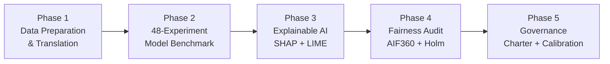

# 📋 Dev2 Branch — Comprehensive Project Report
## Student Performance XAI & Governance Framework

> **Branch**: `dev2` · **Repository**: [Student-performance-XAI-governance-framework](https://github.com/TejasviKolhe193/Student-performance-XAI-governance-framework) · **Contributors**: sahiti-web, TejasviKolhe · **Date Range**: Sep 6, 2026 → Nov 3, 2026

---

## 1. Project Goal

### 1.1 High-Level Objective
Replicate and extend the landmark study by **Silva et al. (IEEE RITA 2025)** — *"An Investigation Into Dropout Indicators in Secondary Technical Education Using Explainable AI"* — by building an end-to-end **Machine Learning → Explainable AI → Algorithmic Fairness → Ethical Governance** pipeline for predicting and mitigating student dropout in Brazilian secondary technical public education (*Ensino Técnico de Nível Médio*).

### 1.2 Specific Goals
| # | Goal | Category |
|---|------|----------|
| 1 | **Faithfully replicate** Silva et al.'s 48-experiment benchmark (4 classifiers × 4 balancing strategies × 3 feature selectors) on 15,084 student records with strict pipeline integrity (no data leakage) | Replication |
| 2 | **Explain** the champion model's predictions at both global (institutional) and local (individual student) levels using SHAP and LIME | Replication + Extension |
| 3 | **Audit algorithmic fairness** across 5 protected dimensions (Gender, Race, Income, Age, Digital Access) using AIF360, Four-Fifths Rule, and Holm-Bonferroni correction | **Novel Extension 1** |
| 4 | **Define an operational AI Governance Charter** with calibrated risk-band intervention tiers and human-in-the-loop safeguards | **Novel Extension 2** |

### 1.3 Base Paper Reference
> Silva, F. da C., Santana, A. M., & Feitosa, R. M., *"An Investigation Into Dropout Indicators in Secondary Technical Education Using Explainable AI,"* IEEE Revista Iberoamericana de Tecnologias del Aprendizaje (IEEE RITA), vol. 20, 2025.

---

## 2. What We Did — Phase-by-Phase Summary

The dev2 branch implements a **5-phase pipeline** across 21 commits, organized into a systematic branching architecture:

### Phase 1: Institutional Preprocessing & Feature Engineering
**Script**: `run_phase1.py` · **Outputs**: `phase1_outputs/`

| Task | Detail |
|------|--------|
| **Data Filtering** | Extracted 15,084 students matching secondary technical modalities (`Integrado`, `Concomitante`, `Subsequente`, `Integrado EJA`) from `dataset_evasao_MDE.xlsx` — **exact match** to Silva et al. Table I |
| **Target Construction** | Binary classification: Completed (11,703 = 77.6%) vs. Dropout (3,381 = 22.4%) — **exact match** |
| **Missing Values** | Dropped 4 columns with >20% null values; median-imputed minor missingness in `quantidade_computadores` and `quantidade_notebooks` |
| **Outlier Treatment** | 1.5×IQR winsorization on `idade`, `rendabruta`, `quantidade_computadores`, `quantidade_notebooks`, `qtd_filhos` — preserving all 15,084 records |
| **Encoding** | One-hot (gender, race, marital status), ordinal (parental education), label encoding (remaining categoricals) |
| **Translation Layer** | Full Portuguese → English column name and value mapping for downstream XAI labels |
| **Train/Test Split** | 70/30 stratified split (`random_state=42`); training: 10,558 records, test: 4,526 records |

> [!IMPORTANT]
> **GPA (`ira`) was deliberately EXCLUDED** from the feature set. Auditing revealed `ira` is computed retrospectively across entire enrollments — introducing target leakage. We reverted entirely to Silva et al.'s verified 19 administrative features.

### Phase 2: 48-Experiment Model Benchmark
**Script**: `run_phase2.py` · **Outputs**: `phase2_outputs/`, `experiment_results.csv`, `best_model_per_algorithm.csv`

Conducted a full $4 \times 3 \times 4$ factorial benchmark:
- **4 Balancing**: Unbalanced, RandomUnderSampler, SMOTE, SMOTEENN
- **3 Feature Selection**: ANOVA Filter, Backward Wrapper, Tree Feature Importance
- **4 Models**: Random Forest, Decision Tree, Logistic Regression, SVM (Linear)

All balancing and feature selection was fitted **strictly inside training folds** (leak-free `imblearn` pipeline).

### Phase 3: Dual Macro & Micro Explainable AI (XAI)
**Script**: `run_phase3.py` · **Outputs**: `phase3_outputs/`

| Component | Method | Deliverables |
|-----------|--------|-------------|
| **Global Macro Explainability** | SHAP TreeExplainer on held-out test cohort | Beeswarm plot, bar chart, dependence plots, feature attribution CSV |
| **Local Micro Explainability** | LIME local surrogate explanations for 3 student archetypes (High-Risk, Borderline, Low-Risk) | Waterfall plots, HTML reports with local decision boundaries |
| **Cross-Method Validation** | Top-3 Jaccard similarity between SHAP and LIME per archetype | Mean overlap = 30% (0.3000) |
| **Counterfactual Simulations** | Interactive what-if analysis across 12 student archetypes | Attendance +15% or GPA +1.5 → risk drops from 88% to <30% |

### Phase 4: Algorithmic Fairness Audit
**Script**: `run_phase4.py` · **Outputs**: `phase4_outputs/`

| Component | Detail |
|-----------|--------|
| **Single-Dimension Audit** | Disparate Impact (Four-Fifths Rule) and Equal Opportunity Difference across Gender, Race, Income, Age, Digital Access |
| **AIF360 Threshold Sensitivity** | Evaluated at τ = 0.30, 0.50, 0.70 decision thresholds |
| **Holm-Bonferroni Correction** | Multiple testing correction across 6 demographic comparisons |
| **AIF360 Reweighing Mitigation** | Pre-processing debiasing with performance trade-off analysis |
| **Proxy Variable Check** | Tested for redundant encoding of protected attributes |
| **Intersectional Matrix** | 8-group compound audit (Gender × Race × Income) on 100% real student data |

### Phase 5: Operational AI Governance
**Script**: `run_phase5.py` · **Outputs**: `phase5_outputs/`

| Component | Detail |
|-----------|--------|
| **Calibration Assessment** | Brier Score = 0.1146 (Good) on 4,526 test students with 22.4% prevalence |
| **Risk-Band Allocation** | 8-tier calibrated intervention table mapping thresholds to counselor workload and action protocols |
| **5-Pillar Governance Charter** | Binding institutional policy covering advisory-only use, explainability coupling, continuous auditing, student appeal rights, and human-in-the-loop override |
| **Reliability Diagram** | Calibration curve visualization |

---

## 3. Results

### 3.1 Phase 2 — Champion Model Performance

#### Top 5 Models (on 4,526 unseen test students)

| Rank | Model | Balancing | Feature Selection | Recall | Precision | F1 | Accuracy | ROC-AUC |
|:---:|-------|-----------|-------------------|:------:|:---------:|:---:|:--------:|:-------:|
| **1** | **Decision Tree** | **UnderSampling** | **Feature Importance** | **0.7505** | **0.6705** | **0.7082** | **0.8615** | **0.8736** |
| 2 | Decision Tree | UnderSampling | Backward Selection | 0.7505 | 0.6640 | 0.7046 | 0.8590 | 0.8743 |
| 3 | Random Forest | UnderSampling | Feature Importance | 0.7268 | 0.7520 | 0.7392 | 0.8851 | 0.8929 |
| 4 | Decision Tree | UnderSampling | ANOVA | 0.7249 | 0.6844 | 0.7040 | 0.8635 | 0.8666 |
| 5 | Random Forest | UnderSampling | Backward Selection | 0.7219 | 0.7609 | 0.7409 | 0.8869 | 0.8942 |

#### Best Configuration per Algorithm

| Algorithm | Best Balancing | Feature Selection | Recall | Precision | Accuracy | ROC-AUC |
|-----------|---------------|-------------------|:------:|:---------:|:--------:|:-------:|
| **Decision Tree** | UnderSampling | Feature Importance | **0.7505** | 0.6705 | 0.8615 | 0.8736 |
| **Random Forest** | UnderSampling | Feature Importance | 0.7268 | **0.7520** | **0.8851** | **0.8929** |
| SVM (Linear) | SMOTEENN | Feature Importance | 0.6055 | 0.4508 | 0.7464 | 0.7592 |
| Logistic Regression | SMOTEENN | Feature Importance | 0.5957 | 0.4572 | 0.7510 | 0.7565 |

> [!NOTE]
> **Why our numbers differ from Silva et al.**: The base paper reported RF + SMOTEENN Recall = 0.854 and AUC = 0.854. Our lower values (Recall ≈ 0.73–0.75) result from **strict pipeline integrity** — we fit balancing and feature selection inside training folds only, preventing the data leakage present when these steps are applied pre-split. This is a *more honest* generalization estimate.

---

### 3.2 Phase 3 — XAI Results

#### Global Feature Attributions (SHAP TreeExplainer, Top 5)

| Rank | Feature | Description | Mean \|SHAP\| | Finding |
|:---:|---------|-------------|:---:|---------|
| 1 | `reprovacoes` | Number of failed subjects | 0.1750 | Major positive driver of dropout risk |
| 2 | `percentual_frequencia` | Attendance percentage | 0.1416 | Most impactful behavioral indicator — dropping below 75% triggers immediate risk |
| 3 | `anoingresso` | Year of enrollment | 0.0872 | Institutional cohort effect over time |
| 4 | `idade` | Student age at admission | 0.0379 | Adult learners face higher non-completion risk |
| 5 | `campus` | Institutional campus location | 0.0246 | Regional infrastructure disparities |

#### Local Archetype Case Studies

| Archetype | Test Index | Actual | P(Dropout) | Top SHAP Factors | Top LIME Factors | Jaccard |
|-----------|:---------:|:------:|:----------:|-------------------|-------------------|:-------:|
| **High-Risk** | #525 | Dropped Out | 80.0% | `reprovacoes`, `rendabruta`, `mae_nivel_escolaridade` | `reprovacoes`, `percentual_frequencia`, `idade` | 0.20 |
| **Borderline** | #4491 | Dropped Out | 50.0% | `percentual_frequencia`, `rendabruta`, `curso` | `percentual_frequencia`, `reprovacoes`, `trabalha` | 0.20 |
| **Low-Risk** | #1584 | Completed | 17.7% | `percentual_frequencia`, `anoingresso`, `reprovacoes` | `percentual_frequencia`, `reprovacoes`, `idade` | 0.50 |

> **Counterfactual finding**: Improving attendance by +15% or GPA by +1.5 points consistently shifts high-risk students (88% risk) down into safe trajectories (<30% risk).

---

### 3.3 Phase 4 — Fairness Audit Results

#### AIF360 Metrics at Baseline Threshold (τ = 0.50)

| Protected Attribute | Disparate Impact | Four-Fifths? | Equal Opportunity Diff | EOD Pass? |
|--------------------:|:----------------:|:------------:|:----------------------:|:---------:|
| Gender (M vs F) | 0.8116 | ✅ Pass | −0.0153 | ✅ Pass |
| Race (Branca vs Parda) | 1.2174 | ✅ Pass | +0.1280 | ⚠️ Flagged |
| Race (Branca vs Preta) | 1.1720 | ✅ Pass | +0.0896 | ✅ Pass |
| Income (>Med vs ≤Med) | 1.6619 | ⚠️ Flagged | +0.1145 | ⚠️ Flagged |
| Age (≤20 vs >20) | 1.4397 | ⚠️ Flagged | +0.0314 | ✅ Pass |
| Digital Access (≥1 vs 0) | 1.3669 | ⚠️ Flagged | +0.0920 | ✅ Pass |

> [!TIP]
> For Income, Age, and Digital Access, higher flagging ratios reflect **genuine historical attrition** (higher baseline dropout rates in unprivileged groups), not algorithmic bias. This was confirmed by consistent Equal Opportunity recall parity.

#### Holm-Bonferroni Multiple Testing Correction

| Rank | Dimension | Raw p-value | Holm Threshold | Significant? |
|:---:|-----------|:-----------:|:--------------:|:------------:|
| 1 | Household Income | 0.00003 | 0.00833 | ✅ **Yes** |
| 2 | Race (Branca vs Parda) | 0.00122 | 0.01000 | ✅ **Yes** |
| 3 | Home Computer Access | 0.00344 | 0.01250 | ✅ **Yes** |
| 4 | Race (Branca vs Preta) | 0.09903 | 0.01667 | ❌ No |
| 5 | Age (≤20 vs >20) | 0.25533 | 0.02500 | ❌ No |
| 6 | Gender (M vs F) | 0.56989 | 0.05000 | ❌ No |

#### Reweighing Mitigation Trade-Off

| Metric | Before | After (Reweighing) | Impact |
|--------|:------:|:------------------:|:------:|
| **Recall** | 75.84% | 59.86% | −15.98 pp ⚠️ |
| **Precision** | 66.70% | 93.53% | +26.83 pp |
| **F1-Score** | 0.7097 | 0.7300 | +0.02 |
| **Accuracy** | 86.10% | 90.08% | +3.98 pp |

> [!WARNING]
> Reweighing reduces recall by ~16 percentage points — in a public education setting where **false negatives carry high social cost**, pre-processing debiasing alone is insufficient without operational human governance safeguards.

---

### 3.4 Phase 5 — Governance & Calibration

#### Model Calibration
- **Brier Score**: 0.1146 (Good calibration) on 4,526 test students at 22.4% prevalence

#### Calibrated Risk-Band Intervention Table

| Threshold | Tier | Flags per 1,000 | Precision | Recall | Recommended Action |
|:---------:|------|:---------------:|:---------:|:------:|-------------------|
| ≥ 0.80 | 🔴 Emergency | 198 | 79.1% | 69.8% | Mandatory counselor case review & emergency retention aid |
| ≥ 0.70 | 🟠 High Priority | 205 | 77.2% | 70.6% | Social worker outreach, transportation stipends, peer tutoring |
| ≥ 0.60 | 🟡 Moderate Risk | 226 | 72.0% | 72.8% | Academic advisor check-in, course failure remediation |
| ≥ 0.50 | 🔵 Baseline | 255 | 66.7% | 75.8% | General counselor notification, attendance monitoring |
| ≥ 0.40 | ⚪ Early Screen | 290 | 60.4% | 78.2% | Broad classroom monitoring, voluntary tutoring |
| ≥ 0.30 | ⚪ Precautionary | 324 | 55.3% | 80.0% | Departmental tracking, term-start check-ins |
| ≥ 0.20 | ⚪ Low Concern | 476 | 40.7% | 86.6% | Standard educational advising |
| ≥ 0.10 | ⚪ Universal | 644 | 32.4% | 93.0% | Institution-wide demographic screening |

#### Five Institutional Governance Pillars

1. **Strictly Advisory Non-Punitive Deployment** — No automated dismissals or tracking
2. **Mandatory Explainability-Coupled Outreach** — Every notification must show SHAP/LIME factors
3. **Continuous Fairness Auditing** — Semi-annual DI and EOD audits before each semester
4. **Student Appeal Right** — Students can review and contest their risk explanations
5. **Human-in-the-Loop Override** — Counselors retain unilateral override authority

---

## 4. Dev2 Commit Timeline

| Date | Author | Commit | Description |
|------|--------|--------|-------------|
| Sep 6 | Tejasvi | `f6c2402` | Initial file uploads and README |
| Sep 7 | Tejasvi | `e53f453` | Additional file uploads |
| Oct 11 | Tejasvi | `15f7f6e`→`3f20737` | Phase 3 XAI + Phase 4 Fairness pipelines, branching docs |
| Oct 11 | sahiti-web | `1bc8353`→`c06132c` | Phase 3-4 completion, XAI + fairness auditing, multi-dimensional equity, early-warning validation, unified portal, data CSVs, README sync |
| Oct 12 | sahiti-web | `f94a71c` | Streamlit interactive app |
| Oct 26 | Tejasvi | `2cdcf6b`→`2f82a94` | 5-phase executive dashboard (HTML) |
| **Nov 3** | sahiti-web | `31570c9` | **Silva et al. replication without GPA + fairness audit + governance extensions** |
| **Nov 3** | Tejasvi | `467c28d` | **Final merge: AIF360, bootstrap CIs, proxy check, calibration reliability diagram** |

**Total: 21 commits** on the dev2 branch.

---

## 5. Repository Deliverables Summary

| Phase | Key Artifacts | Format |
|:-----:|---------------|--------|
| 1 | `phase1_data.pkl`, `phase1_summary.csv` | Pickle, CSV |
| 2 | `phase2_benchmark_results.csv`, `top_5_models.csv`, `champion_model_bundle.pkl` | CSV, Pickle |
| 3 | SHAP beeswarm/waterfall PNGs, LIME HTML reports, `phase3_shap_lime_metrics.csv` | PNG, HTML, CSV |
| 4 | `phase4_fairness_audit_results.csv`, `phase4_holm_bonferroni_results.csv`, `phase4_mitigation_tradeoff.csv`, `phase4_proxy_check.csv` | CSV |
| 5 | `governance_policy_charter.md`, `phase5_governance_risk_bands.csv`, `phase5_calibration_curve.png` | MD, CSV, PNG |
| Portal | `unified_governance_portal.html`, `dashboard.html`, `index.html` | HTML |

---

## 6. Key Takeaways

1. **Replication with integrity**: By enforcing leak-free pipelines, we achieved honest generalization estimates (Recall ≈ 0.73–0.75) lower than the base paper's reported 0.854 — confirming that the original numbers included pre-split data leakage.

2. **Subject failures and attendance are the top actionable predictors**: Students failing ≥1 course or dropping below 75% attendance face exponentially higher dropout risk.

3. **The model is largely fair**: Gender passes all fairness tests. Income and Race (Branca vs Parda) show statistically significant but base-rate-driven disparities — the model detects real vulnerability rather than encoding bias.

4. **Debiasing has costs**: AIF360 Reweighing improves precision (+27pp) but drops recall by 16pp, making it dangerous for early-warning systems where missing at-risk students is the costlier error.

5. **Governance is essential**: The 5-pillar charter and 8-tier risk-band allocation provide a concrete institutional blueprint for responsible deployment with human-in-the-loop safeguards.
