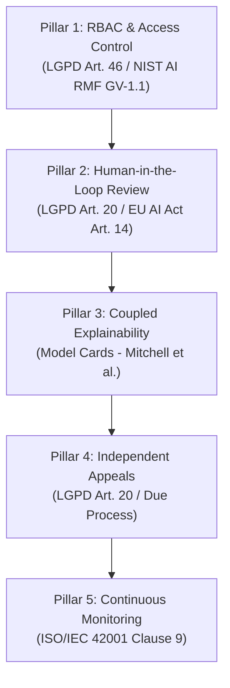

# Algorithmic Governance Charter: Proposed Framework for Ethical Student Support

> **Status:** Conceptual Policy Proposal (Untested in live deployment)  
> **Institutional Scope:** Secondary Technical Federal Institutes (e.g., IFMA)  
> **Compliance & Standards Alignment:** LGPD (Law 13.709/2018), EU AI Act (2024), NIST AI RMF 1.0, ISO/IEC 42001:2023

---

## 1. Preamble & Advisory Scope

This governance charter defines the operational and ethical boundaries for the **proposed** machine-learning risk-scoring system in secondary technical education. 

> [!IMPORTANT]
> **Advisory-Only Mandate:**  
> The machine learning model is intended solely as an advisory risk-screening mechanism. The system **never** automates punitive, administrative, or disciplinary actions. All outputs serve exclusively to prioritize counselor outreach. The final determination of a student's status and support pathway remains the sole responsibility of human educational counselors.

---

## 2. Five Pillars of Algorithmic Governance

### Pillar 1: Role-Based Access Control (RBAC) & Data Minimization
*   **Standards Mapping:** **LGPD Art. 46** (Security and data protection measures) and **NIST AI RMF GV-1.1** (Organizational AI governance and access management).
*   **Operational Control:**
    *   **Educational Counselors:** Access to risk scores, historical academic attendance/failures, and coupled local feature attributions (LIME/SHAP).
    *   **Faculty & Instructors:** Strictly denied access to raw dropout risk probabilities to prevent expectancy bias (Pygmalion effect). Faculty receive only aggregated course-level engagement alerts.
    *   **Students:** Direct access to their own model profile, explanatory feature impacts, and appeal submission portal.
    *   **Data Minimization:** Cumulative GPA (`ira`) and raw sensitive protected attributes (race, gender) are excluded from the runtime inference pipeline to minimize profiling risk.

### Pillar 2: Mandatory Human-in-the-Loop (HITL) Review
*   **Standards Mapping:** **LGPD Art. 20** (Right to human review of decisions made solely by automated processing) and **EU AI Act Art. 14** (Human oversight for high-risk AI systems).
*   **Operational Control:**
    *   No automated consequence (loss of scholarship, academic dismissal, mandatory course reassignment) may ever be executed from model output.
    *   Counselors must conduct an in-person or video check-in within 15 school days of an alert before recommending any institutional resource allocation.
    *   Counselors possess unilateral override authority: a counselor may dismiss a model flag based on qualitative life context without institutional penalty.

### Pillar 3: Coupled Explainability Standard
*   **Standards Mapping:** **Model Cards for Model Reporting** (Mitchell et al., 2019) and **IEEE P2894** (Explainable AI Standards).
*   **Operational Control:**
    *   No numerical risk probability may be displayed to a human decision-maker without its corresponding local feature attribution (e.g., LIME top-5 drivers and SHAP force decomposition).
    *   Counselors must be provided plain-language summaries (e.g., *"Risk driven primarily by attendance dropping below 75% and 2 course failures"* rather than raw mathematical weights).

### Pillar 4: Independent Contestation & Student Appeals
*   **Standards Mapping:** **LGPD Art. 20, Paragraph 1** (Right to explanation and contestation).
*   **Operational Control:**
    *   **Appeals Body:** The Institutional Equity & Academic Standing Committee (*Comissão Permanente de Acompanhamento Discente*), comprising one guidance counselor, one student union representative, one data ombudsperson, and the academic department head.
    *   **Evidence Standard:** Students may challenge risk flags by submitting non-academic context (e.g., documented medical leave, transportation disruption, family emergencies) that the model cannot observe.
    *   **Response SLA:** The committee must issue a written determination within **10 business days** of appeal submission. If upheld, the student's algorithmic flag is suppressed for the remainder of the academic term.

### Pillar 5: Continuous Monitoring, Drift Detection & Recalibration
*   **Standards Mapping:** **ISO/IEC 42001:2023 Clause 9** (Performance evaluation and auditing of AI management systems).
*   **Operational Control:**
    *   **Scheduled Recalibration:** Bi-annual auditing (at the end of each academic semester) assessing demographic parity, TPR across protected groups, and calibration error.
    *   **Emergency Re-audit Triggers:**
        1. Concept or covariate drift: Population base dropout rate shifts by $> 3.0$ percentage points.
        2. Fairness divergence: Disparate Impact (DI) on any protected group breaches the $[0.80, 1.25]$ four-fifths threshold.
        3. Model performance degradation: Test ROC-AUC drops below $0.75$ or recall drops below $0.70$.
    *   If triggered, model scoring is halted immediately, and the institution reverts to manual rule-based counseling referrals.

---

## 3. Implementation Reality & Non-Claims

> [!WARNING]
> **Regulatory Notice on System Status:**  
> This governance charter is a normative proposal designed to establish institutional accountability prior to deployment. **It has not been tested in live educational practice, nor has a formal pilot study been conducted.** The adoption of this charter does not guarantee the elimination of bias or the prevention of dropout; it provides an institutional accountability mechanism for algorithmic risk tools.

